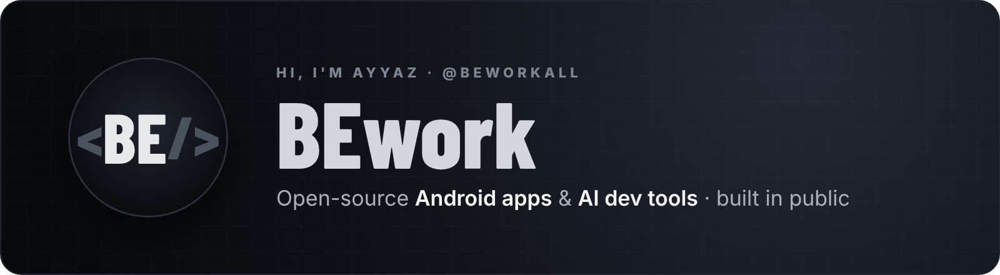
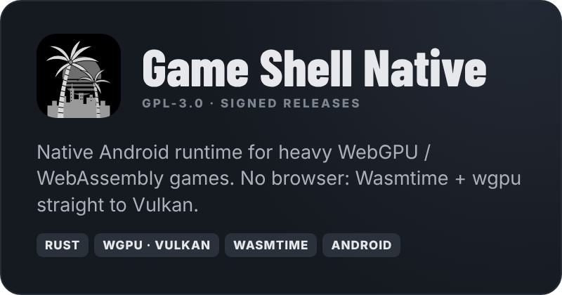
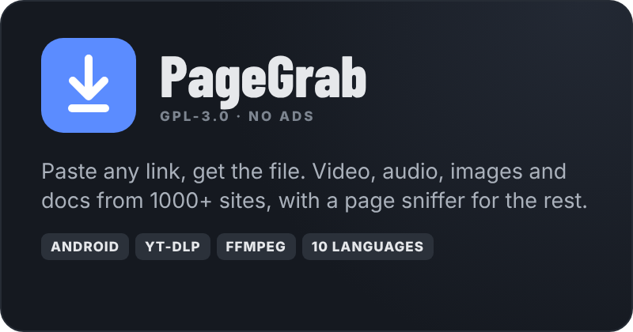
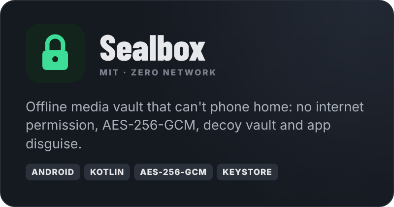
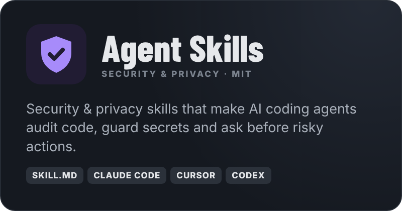

  

  

  
  
  

---

### ⚡ About

I build **open-source Android apps and AI developer tools**, and ship them in public, from first commit to signed release.

- 🛠️ I like hard problems: native runtimes, encryption, media engines, agent tooling.
- 🔓 Everything I publish is **open source**, with **no ads, no tracking and no accounts**.
- 🚀 Ship fast, release often: every project builds and publishes itself through GitHub Actions.
- 💬 Ask me about **Rust, Android internals, yt-dlp, Vulkan / wgpu, or AI agent skills**.

---

### 🧩 Featured projects

<table>
  <tr>
    <td width="50%"></td>
    <td width="50%"></td>
  </tr>
  <tr>
    <td width="50%"></td>
    <td width="50%"></td>
  </tr>
</table>

| Project | What it is | Get it |
|---|---|---|
| 🌴 **[Game Shell Native](https://github.com/beworkall/game-shell-native)** | Native Android runtime for WebGPU / WebAssembly games: Rust + Wasmtime + wgpu on Vulkan, Winlator-style controls | [Releases](https://github.com/beworkall/game-shell-native/releases/latest) |
| ⬇️ **[PageGrab](https://github.com/beworkall/PageGrab)** | Paste any link, get the file: bundled yt-dlp + ffmpeg, page sniffer, background queue, 10 languages | [Releases](https://github.com/beworkall/PageGrab/releases/latest) |
| 🔒 **[Sealbox](https://github.com/beworkall/sealbox)** | Offline media vault with no internet permission: AES-256-GCM, Keystore-sealed keys, decoy vault, app disguise | [Releases](https://github.com/beworkall/sealbox/releases/latest) |
| 🛡️ **[Agent Skills](https://github.com/beworkall/agent-skills-security)** | Security & privacy `SKILL.md` pack for Claude Code, Cursor and Codex | `npx skills@latest add beworkall/agent-skills-security` |

---

### 🧰 Tech stack

  
  
  
  
  
  
  
  

  
  
  
  
  
  
  
  

---

### 🐍 Contributions

<picture>
  <source media="(prefers-color-scheme: dark)" srcset="https://raw.githubusercontent.com/beworkall/beworkall/output/snake-dark.svg">
  <source media="(prefers-color-scheme: light)" srcset="https://raw.githubusercontent.com/beworkall/beworkall/output/snake-light.svg">
  
</picture>

---

  Open source · no ads · no tracking · <b>We work in silence. We deliver as one. Expect BEwork.</b>

